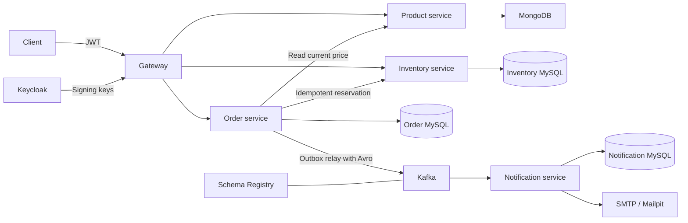

# Commerce Backend

A Java 21 and Spring Boot 3 backend for an online shop. Products use MongoDB. Orders, inventory reservations, and notifications each use a separate MySQL database. Spring Cloud Gateway routes API requests, Keycloak issues access tokens, and Kafka carries Avro order confirmations.

Based on [Sai Upadhyayula's Spring Boot microservices course](https://github.com/SaiUpadhyayula/spring-boot-3-microservices-course), with stock reservations, idempotent checkout, a transactional outbox, and a persistent notification inbox.

## Architecture



| Service | Responsibility | Internal port |
| --- | --- | --- |
| api-gateway | JWT validation, admin permissions, trusted customer identity, routing | 9000 |
| product-service | Product creation, lookup by SKU, paginated listing | 8080 |
| inventory-service | Stock levels and durable reservations | 8082 |
| order-service | Price snapshots, idempotent checkout, processing, outbox relay | 8081 |
| notification-service | Deduplicate events and retry email delivery | 8083 |

Prometheus collects metrics, Tempo receives traces, and Alloy ships container logs to Loki. Grafana includes provisioned data sources and a service dashboard. Kubernetes manifests mirror the local service topology.

## Run locally

Install Docker Desktop with Linux containers and Compose v2. Allocate roughly 10–12 GB of memory for the full stack. A host JDK is only needed when building outside Docker.

From the workspace root:

```powershell
Copy-Item .env.example .env
docker compose up --build -d
docker compose ps
./scripts/smoke-test.ps1
```

The first build downloads Maven dependencies and container images. Keycloak's realm import can take a little longer than the application containers; rerun the smoke test once its login endpoint is ready.

To include monitoring:

```powershell
docker compose --profile observability up --build -d
```

| Tool | URL | Local credentials |
| --- | --- | --- |
| Public API | http://localhost:9000 | Bearer token |
| Keycloak console | http://localhost:8181 | admin / local-admin-password |
| Mailpit inbox | http://localhost:8025 | None |
| Schema Registry subjects | http://localhost:8085/subjects | None |
| Grafana | http://localhost:3000 | admin / local-grafana-password |
| Prometheus | http://localhost:9090 | None |

The imported API users are customer / local-customer-password and catalog-admin / local-catalog-password. The admin account can create products and set stock; customers can browse, check availability, and place or retrieve their own orders.

Only the gateway exposes an application port in Compose. The database, identity, broker, and development tooling ports bind to localhost. Stop the stack with `docker compose --profile observability down`; named volumes retain data. The older per-service Compose files are compatibility entry points for their databases.

## Try the API

Get a customer token:

```powershell
$token = (Invoke-RestMethod -Method Post -Uri "http://localhost:8181/realms/commerce/protocol/openid-connect/token" -Body @{
    grant_type = "password"
    client_id = "commerce-cli"
    username = "customer"
    password = "local-customer-password"
}).access_token
$headers = @{ Authorization = "Bearer $token" }
Invoke-RestMethod "http://localhost:9000/api/product?page=0&size=20" -Headers $headers
```

Use the smoke script to create a fresh SKU and seed stock before ordering. A checkout body contains SKU, quantity, and email. Prices and order numbers are assigned by the server.

```powershell
$headers["Idempotency-Key"] = [guid]::NewGuid().ToString()
$order = Invoke-RestMethod -Method Post -Uri "http://localhost:9000/api/order" -Headers $headers -ContentType "application/json" -Body '{"skuCode":"iphone_15","quantity":1,"email":"buyer@example.com"}'
Invoke-RestMethod "http://localhost:9000/api/order/$($order.orderNumber)" -Headers $headers
```

The inventory migration seeds sample iPhone SKUs, but matching products must be created first. The smoke script creates its own matching product and inventory entry.

| Method | Route | Access |
| --- | --- | --- |
| GET | /api/product?page=0&size=20 | Authenticated |
| GET | /api/product/{skuCode} | Authenticated |
| POST | /api/product | Admin |
| GET | /api/inventory?skuCode=keyboard&quantity=2 | Authenticated |
| PUT | /api/inventory/{skuCode} | Admin |
| POST | /api/order | Authenticated; Idempotency-Key required |
| GET | /api/order/{orderNumber} | Order owner |

Product creation accepts `skuCode`, `name`, `description`, and a positive `price` with up to two decimal places. Stock updates accept `{"quantity":5}`. Quantities in an order must be between 1 and 1000. This shop uses USD throughout.

A new order returns HTTP 202 and status PENDING. Poll the returned order number until it becomes CONFIRMED or REJECTED. An inventory timeout leaves it PENDING for retry. Reusing a key with the same customer and payload returns the original order; changing the payload returns HTTP 409. Validation errors use Problem Details with field errors.

OpenAPI JSON is available at each service's `/v3/api-docs` endpoint. When accessing a backend directly, supply the `X-Internal-Token` header. For example, port-forward a product-service pod and run:

```powershell
Invoke-RestMethod "http://localhost:8080/v3/api-docs" -Headers @{ "X-Internal-Token" = "local-service-token" }
```

## Build and test

Use a PowerShell session permitted to execute local scripts. On Windows, run the complete verification sequence with `./scripts/verify.ps1` after starting Docker Desktop. It runs the Maven integration profile, builds and starts the containers, waits for the imported Keycloak realm, and executes the smoke test. Add `-Observability` to include monitoring. Logs are saved under `.tools/verification`; failures stop the sequence and successful runs leave the services running.

Use Java 21 or a compatible newer JDK. The Maven wrapper downloads Maven 3.9.9.

```powershell
./mvnw.cmd test
./mvnw.cmd -Pintegration verify
```

On Linux or macOS use `bash mvnw`. The integration profile requires a running Docker engine and downloads pinned MongoDB and MySQL images. CI runs the same profile on Java 21.

Unit and HTTP-client tests cover product conflicts, server-side pricing, idempotency, ownership, stock deduction, reservation replay, timeout retries, confirmation events, notification deduplication, and gateway permissions. Integration tests exercise real MongoDB indexes, request validation, MySQL migrations, concurrent stock reservations, and order/outbox transaction rollback. The smoke script verifies the assembled Kafka, Schema Registry, Keycloak, and SMTP path.

To run a service from your IDE, start its infrastructure with the root Compose file, install the shared library with `./mvnw.cmd -pl backend-common -am install -DskipTests`, then launch its main class. Default host connection settings match the published infrastructure ports.

## Kubernetes

The manifests use a local development cluster with dynamic volume provisioning, one replica per stateful dependency, local credentials, and ClusterIP services.

```powershell
kind create cluster --name commerce
./scripts/build-kind.ps1
kubectl apply -f k8s/infrastructure.json
kubectl apply -f k8s/applications.json
kubectl -n commerce rollout status deployment/api-gateway --timeout=300s
kubectl -n commerce port-forward service/api-gateway 9000:9000
```

In separate terminals, forward Keycloak with `kubectl -n commerce port-forward service/keycloak 8181:8080` and Mailpit with `kubectl -n commerce port-forward service/mailpit 8025:8025`. Then run the same smoke script.

Apply `k8s/observability.json` for monitoring. Forward Grafana with `kubectl -n commerce port-forward service/grafana 3000:3000`. Alloy runs on each node and reads CRI logs from /var/log/pods. The JSON files are standard Kubernetes List manifests accepted by kubectl.

## Order processing and limitations

The checkout workflow and its failure cases are described in [docs/order-processing.md](docs/order-processing.md). Key constraints are:

- Inventory reservations persist their result by order number and lock the SKU while deducting stock. A retry returns the same result, including a previous rejection.
- Order confirmation and its outbox entry commit in one database transaction. Kafka publishing is at least once; notifications deduplicate by event ID.
- SMTP delivery can repeat if the process stops after the mail server accepts a message but before the sent timestamp commits. A provider with idempotency support would close this gap.
- Pending reservations retry with bounded backoff. There is no cancellation, payment capture, reservation expiry, or administrative recovery API yet.
- Stock PUT sets absolute available stock and is an administrative operation. Product prices are snapshotted at submission.
- Gateway identity is verified with issuer, audience, signature, and expiry checks. Backend calls use a shared internal credential, intended for this local trusted network.
- Development uses HTTP, plaintext Kafka, direct password login, and sample credentials. An internet deployment needs TLS, private infrastructure, managed secrets, service identity, authorization-code login with PKCE, broker authentication, backups, and high availability.
- The monitoring profile samples every trace for demonstration. Tune sampling and retention for a deployed environment.
