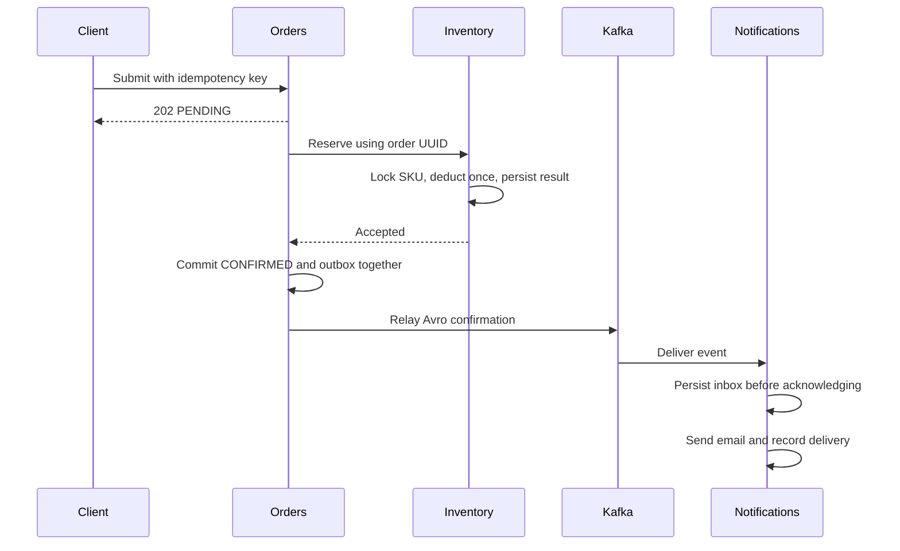

# Order processing

Checkout is asynchronous after the initial price lookup. The client supplies an idempotency key; the gateway supplies the verified customer subject. The database enforces a unique key on that pair.

## Submission

The order service first looks for the customer's key. If it exists, it compares SKU, quantity, and email. A matching request returns the existing order; a changed request receives a conflict. A new request fetches the current price from the product service and stores a PENDING order with a server-generated UUID.

The price lookup has connect and read timeouts. A catalogue failure returns HTTP 503 before an order is created. Concurrent submissions with the same key race against a database uniqueness constraint; the losing request reads the winner and applies the same payload comparison.

## Reservation and confirmation

A scheduled worker selects eligible PENDING orders. Each order is locked while its reservation call runs. The inventory service locks the SKU row, checks for an existing reservation, and persists either acceptance or rejection. Acceptance and stock deduction commit together.

A successful reservation moves the order to CONFIRMED and inserts an outbox row in the same order-database transaction. A rejection moves it to REJECTED. Transient errors leave it PENDING and advance its next retry time with exponential backoff capped at 60 seconds.

If inventory commits but the response is lost, retrying the same order UUID returns the recorded result without another deduction. If the order transaction rolls back after acceptance, its PENDING row remains eligible for that same retry. A worker process restart therefore does not depend on an in-memory queue.

Database locks remain held during the short inventory call. This is a deliberate simplicity tradeoff for the local project. At higher throughput, lease-based job claiming would avoid holding a database connection during network I/O.

## Event delivery

The outbox relay locks one unpublished row, sends its Avro event, waits for broker acknowledgement, and marks it published. The event ID is created once with the outbox row. An acknowledgement followed by a database failure causes a later duplicate publication.

The notification consumer stores the event ID as its primary key. Its transaction completes before the listener returns and Kafka acknowledges the record. Replayed IDs do not create another notification. Database failures keep the Kafka record retryable; repeated failures can block that partition and require operator attention.

The email worker selects due notifications, locks each row, and records a sent timestamp only after SMTP accepts it. Delivery errors back off up to 300 seconds. Notifications survive restarts, but SMTP itself does not provide an exactly-once guarantee.

## Failure cases

| Failure | Result |
| --- | --- |
| Product catalogue unavailable | HTTP 503; no order created |
| Client retries a timed-out submission | Existing order returned for the same key and payload |
| Two customers request the last unit | SKU row lock permits only one acceptance |
| Inventory unavailable or response lost | Order stays PENDING and retries with the same UUID |
| Order transaction fails after stock deduction | Reservation replay allows confirmation on retry |
| Kafka or Schema Registry unavailable | Confirmation remains committed; unpublished outbox row retries |
| Relay crashes after broker acknowledgement | Same event ID may be delivered again |
| Notification database unavailable | Kafka record retries before acknowledgement |
| SMTP unavailable | Inbox row remains due for a later attempt |

No distributed transaction spans MySQL, MongoDB, Kafka, and SMTP. Each service owns its database. Reservation IDs, outbox rows, and inbox IDs provide recovery at the boundaries where a remote call can succeed without its caller observing the response.
